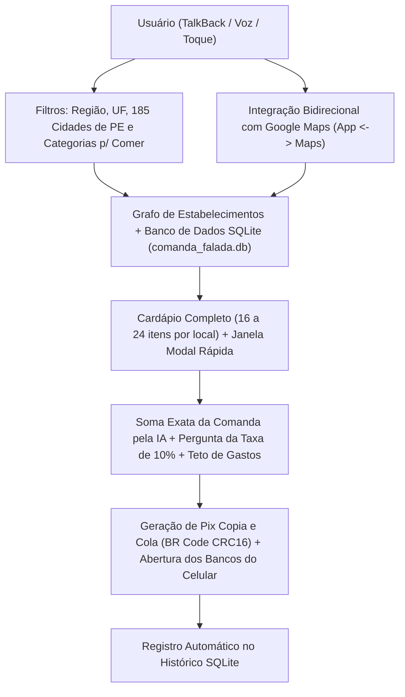

# 📋 Relatório Geral de Desenvolvimento — Comanda Falada · Passo à Frente (v6.0)

**Aluno:** Edson Amorim (`edsoninformatica28br@gmail.com`)  
**Disciplina:** Tópicos em Inteligência Artificial (*AI for Good* · UFRPE)  
**Repositório Oficial:** [C:\topicos-em-ia](file:///C:/topicos-em-ia) (`https://github.com/Edson-amorim/topicos-em-ia`)  
**APK Final Pronto para Instalação:** [comanda-falada.apk](file:///C:/topicos-em-ia/tec/comanda-falada.apk) (`115,5 KB`, independente, assinado com V1/V2/V3)

---

## 1. Visão Geral da Arquitetura do Aplicativo Android (`v6.0`)

O aplicativo **Comanda Falada · Passo à Frente** foi projetado para garantir **autonomia gastronômica, espacial e financeira** a pessoas cegas, com baixa visão e demais usuários ao escolher um local para comer, consultar o cardápio completo, somar a comanda sem erros e pagar via Pix no próprio celular.

---

## 2. Tudo o que Foi Implementado no Aplicativo Android

### 2.1. Leitor de Tela Nativo do Sistema Android (TalkBack)
- **Arquivo:** [`MainActivity.java`](file:///C:/topicos-em-ia/tec/android_app/src/br/ufrpe/comandafalada/MainActivity.java#L3140-L3160)
- **O que foi feito:**
  - Foi **removido qualquer sintetizador `TextToSpeech` interno** para nunca competir com nem atropelar o leitor de tela do usuário.
  - Toda a comunicação sonora utiliza exclusivamente a API nativa de acessibilidade do Android (`AccessibilityManager`, `View.announceForAccessibility(...)`, `AccessibilityEvent.TYPE_ANNOUNCEMENT`, `contentDescription` detalhado em todos os botões e `accessibilityLiveRegion="polite"`).

### 2.2. Filtros Geográficos Completos (Região, Estado/UF e Todas as 185 Cidades de Pernambuco)
- **Arquivo:** [`MainActivity.java`](file:///C:/topicos-em-ia/tec/android_app/src/br/ufrpe/comandafalada/MainActivity.java#L150-L270)
- **O que foi feito:**
  - **Filtro por Região (`REGIOES_BRASIL`):** Filtra pelas 5 regiões do Brasil (*Nordeste*, *Sudeste*, *Sul*, *Centro-Oeste* e *Norte*).
  - **Filtro por Estado (`ESTADOS_BRASIL`):** Abrange todas as 27 Unidades Federativas do Brasil (`AC` a `TO`).
  - **Filtro por Cidade (`TODAS_CIDADES_PERNAMBUCO`):** Inclui **todos os 185 municípios de Pernambuco** (do Recife e Região Metropolitana ao Agreste e Sertão, além de Fernando de Noronha), as principais cidades dos demais 26 estados e uma ferramenta no topo da lista (**`🔎 Pesquisar / Digitar Nome da Cidade...`**) para localizar qualquer município rapidamente.

### 2.3. Filtro por Categorias (Exclusivo para Locais onde o Usuário Pode Comer e Consumir)
- **Arquivo:** [`MainActivity.java`](file:///C:/topicos-em-ia/tec/android_app/src/br/ufrpe/comandafalada/MainActivity.java#L159-L168)
- **O que foi feito:**
  - Atendendo à regra de que todo estabelecimento do app deve ser um local onde o usuário possa comer e consumir, foram implementadas **8 categorias gastronômicas**:
    1. `Todas as Categorias (Para Comer e Consumir)`
    2. `Restaurantes, Bistrôs e Self-Service`
    3. `Bares, Botecos e Petiscarias`
    4. `Padarias, Cafeterias e Confeitarias`
    5. `Pizzarias, Hamburguerias e Lanchonetes`
    6. `Churrascarias, Espetinhos e Peixarias`
    7. `Sorveterias, Açaí, Docerias e Tapiocarias`
    8. `Mercados Gastronômicos, Quiosques e Bistrôs Culturais`

### 2.4. Integração de Mão Dupla com o Google Maps (`App <-> Maps`)
- **Arquivos:** [`AndroidManifest.xml`](file:///C:/topicos-em-ia/tec/android_app/AndroidManifest.xml#L18-L49) e [`MainActivity.java`](file:///C:/topicos-em-ia/tec/android_app/src/br/ufrpe/comandafalada/MainActivity.java#L800-L1010)
- **O que foi feito:**
  - **Do Comanda Falada para o Google Maps:**
    - Botão `📍 Maps` ao lado de cada estabelecimento na lista;
    - Botão `📍 Rota no Maps` para abrir a navegação GPS até o estabelecimento selecionado;
    - Botão `🗺️ Ver no Maps` para explorar estabelecimentos da cidade e categoria filtradas diretamente no mapa.
  - **Do Google Maps para o Comanda Falada (Abrir Cardápio pelo Maps):**
    - Configurados `intent-filter`s (`ACTION_SEND` `text/plain` e `ACTION_VIEW` para esquemas `geo:`, `maps.google.com`, `google.com/maps`, `maps.app.goo.gl` e `goo.gl`).
    - Quando o usuário abre um restaurante ou bar no **Google Maps**, toca em **"Compartilhar"** e escolhe **Comanda Falada**, o aplicativo extrai o nome e a cidade do local e **abre imediatamente o cardápio completo** daquele estabelecimento.

### 2.5. Cardápio Completo (16 a 24 Itens por Local) + Janela Modal Rápida + Salto de Foco no TalkBack
- **Arquivos:** [`MainActivity.java`](file:///C:/topicos-em-ia/tec/android_app/src/br/ufrpe/comandafalada/MainActivity.java#L1767-L2250) e [`activity_main.xml`](file:///C:/topicos-em-ia/tec/android_app/res/layout/activity_main.xml#L268-L320)
- **O que foi feito:**
  - **Enriquecimento Completo (`completarCardapioDoEstabelecimento`):** Todos os estabelecimentos possuem entre **16 e 24 itens** divididos em seções claras (*Entradas*, *Petiscos*, *Pratos Principais*, *Pratos Individuais*, *Pizzaria/Hamburgueria/Tapiocaria/Padaria*, *Bebidas sem Álcool*, *Bebidas Alcoólicas/Drinks* e *Sobremesas/Cafeteria*).
  - **Janela Modal Rápida (`abrirDialogoCardapioCompletoInterativo`) e Rolagem Automática (`rolarParaCardapioEAbrirJanelaCompleta`):** Ao tocar em qualquer estabelecimento na lista (ou abrir pelo Google Maps), o app rola automaticamente até a Seção 2, move o foco do TalkBack para o título do cardápio e abre uma janela com **100% dos itens numerados** para adição imediata na comanda.

### 2.6. Soma Determinística da Comanda + Pergunta dos 10% do Garçom + Pagamento nos Bancos do Celular
- **Arquivo:** [`MainActivity.java`](file:///C:/topicos-em-ia/tec/android_app/src/br/ufrpe/comandafalada/MainActivity.java#L2340-L2800)
- **O que foi feito:**
  - **Cálculo Exato em Centavos:** Evita qualquer alucinação aritmética de LLMs somando cada item em centavos inteiros (`R$`).
  - **Pergunta sobre os 10% (`perguntarTaxaDezPorCento`):** Pergunta por voz (via TalkBack) e em caixa de diálogo se o usuário deseja incluir os **10% de taxa de serviço**, detalhando o **Subtotal dos Itens**, o **Valor dos 10%** e a **Soma Total com ou sem os 10%**.
  - **Teto de Gastos Configurável:** Alerta sonoro e visual quando a comanda ultrapassa o limite escolhido (`R$ 50`, `R$ 100`, `R$ 150` ou `R$ 200`).
  - **Pix Copia e Cola (BR Code BACEN com CRC16) + Abertura dos Apps de Bancos:** Gera o payload Pix oficial, copia para a área de transferência e detecta automaticamente os aplicativos de bancos instalados no celular (*Nubank*, *Banco Inter*, *Itaú*, *Bradesco*, *Banco do Brasil*, *Caixa*, *Caixa Tem*, *Santander*, *PicPay*, *Mercado Pago*, *C6 Bank*, *PagBank*, *Neon*, *Next*, *Will Bank*, *Sicredi*, *Sicoob*), abrindo o banco escolhido com 1 toque.

### 2.7. Banco de Dados Relacional Nativo `SQLite` (`comanda_falada.db`)
- **Arquivo:** [`ComandaBancoDadosHelper.java`](file:///C:/topicos-em-ia/tec/android_app/src/br/ufrpe/comandafalada/ComandaBancoDadosHelper.java)
- **O que foi feito:**
  - Criado banco de dados relacional offline com **5 tabelas**:
    1. `estabelecimentos`: persiste todos os locais do catálogo e locais vindos do Google Maps/filtros;
    2. `cardapio_itens`: persiste todos os itens de cardápio e novos pratos cadastrados pelo usuário;
    3. `comanda_ativa`: salva cada item adicionado ou removido da comanda em tempo real (protegendo os dados caso o app seja fechado ou o celular bloqueie);
    4. `configuracoes_sessao`: guarda o último estabelecimento aberto, o teto de gastos e a preferência dos 10%;
    5. `historico_comandas`: grava o histórico permanente de comandas fechadas e pagamentos Pix realizados.
  - Adicionados os botões **`➕ Cadastrar Novo Prato / Bebida no Banco de Dados (SQLite)`** e **`🗄️ Banco de Dados SQLite: Salvar / Ouvir Histórico de Comandas`**.

### 2.8. Ícone Oficial Acessível Personalizado
- **Arquivos:** [`gerar_icone.ps1`](file:///C:/topicos-em-ia/tec/gerar_icone.ps1) e [`icone_comanda_falada.png`](file:///C:/topicos-em-ia/tec/icone_comanda_falada.png)
- **O que foi feito:**
  - Ícone gerado em todas as densidades Android (`mdpi`, `hdpi`, `xhdpi`, `xxhdpi`, `xxxhdpi`) apresentando o **Símbolo Universal da Acessibilidade** no topo e **duas pessoas (uma pessoa com deficiência em cadeira de rodas e uma pessoa em pé sem deficiência) segurando juntas um cardápio aberto**.

---

## 3. Resumo dos Artefatos Acadêmicos Concluídos no Repositório

| Artefato / Arquivo | Caminho no Repositório | Status |
| :--- | :--- | :--- |
| **Artefato 1 — Brainwriting Híbrido** | [va2/brw.md](file:///C:/topicos-em-ia/va2/brw.md) | ✅ Concluído |
| **Artefato 2 — Competidores e Contribuição** | [va2/cmp.md](file:///C:/topicos-em-ia/va2/cmp.md) | ✅ Concluído e Auditado |
| **Artefato 3 — Tecnologia Base Demonstrável** | [va2/tec.md](file:///C:/topicos-em-ia/va2/tec.md) | ✅ Concluído e Auditado |
| **Apresentação Web Interativa e Acessível** | [apresentacao.html](file:///C:/topicos-em-ia/apresentacao.html) | ✅ Concluída |
| **Vídeo Demonstrativo com Voz e Captura Android** | [tec/demonstracao.mp4](file:///C:/topicos-em-ia/tec/demonstracao.mp4) | ✅ Concluído |
| **Aplicativo Android Nativo (APK v6.0 + SQLite)** | [tec/comanda-falada.apk](file:///C:/topicos-em-ia/tec/comanda-falada.apk) | ✅ Compilado e Assinado |
| **Documento de Transição de Sessão (Handoff)** | [HANDOFF.md](file:///C:/topicos-em-ia/HANDOFF.md) | ✅ Atualizado e no GitHub |
