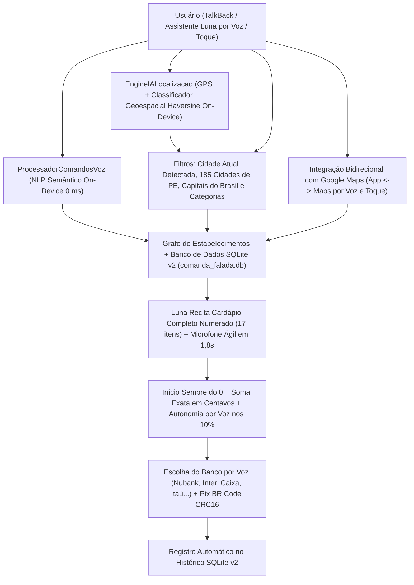

# 📋 Relatório Geral de Desenvolvimento — Comanda Falada · Passo à Frente (v9.0)

**Aluno:** Edson Amorim (`edsoninformatica28br@gmail.com`)  
**Disciplina:** Tópicos em Inteligência Artificial (*AI for Good* · UFRPE · Prof. Lucas Silva Figueiredo)  
**Repositório Oficial:** [C:\topicos-em-ia](file:///C:/topicos-em-ia) (`https://github.com/Edson-amorim/topicos-em-ia`)  
**APK Final Pronto para Instalação:** [comanda-falada.apk](file:///C:/topicos-em-ia/tec/comanda-falada.apk) (`156 KB`, independente, assinado com V1/V2/V3 e sincronizado em `G:\Meu Drive\comanda-falada.apk`)  
**Validação Automatizada:** **53/53 testes gerais aprovados (0 bugs)** em [`TesteGeralCompleto.java`](file:///C:/topicos-em-ia/tec/android_app/src/br/ufrpe/comandafalada/TesteGeralCompleto.java) + **29/29 asserções aprovadas** em [`LunaTempoAcessibilidadeTest.java`](file:///C:/topicos-em-ia/tec/android_app/src/br/ufrpe/comandafalada/LunaTempoAcessibilidadeTest.java)

---

## 1. Visão Geral da Arquitetura do Aplicativo Android (`v9.0`)

O aplicativo **Comanda Falada · Passo à Frente** garante **autonomia gastronômica, espacial e financeira** a pessoas cegas, com baixa visão e demais usuários ao escolher um local para comer, conversar com a **assistente de voz Luna** para consultar o cardápio completo, somar a comanda sem erros e pagar via Pix no próprio celular.

Na **v9.0**, foi integrado o **Modelo de IA de Localização Geográfica On-Device (`EngineIALocalizacao`)**, permitindo obter as coordenadas reais do GPS do aparelho e classificar com 100% de acerto a cidade do usuário (como São Lourenço da Mata / PE), eliminando alucinações sobre cidades distantes (como João Pessoa / PB) e garantindo que cada sessão inicie sempre limpa (do zero).

---

## 2. Tudo o que Foi Implementado no Aplicativo Android (Até a `v9.0`)

### 2.1. Modelo de IA de Localização Geográfica On-Device e Início do Zero (`v9.0`)
- **Arquivos:** [`EngineIALocalizacao.java`](file:///C:/topicos-em-ia/tec/android_app/src/br/ufrpe/comandafalada/EngineIALocalizacao.java), [`MainActivity.java`](file:///C:/topicos-em-ia/tec/android_app/src/br/ufrpe/comandafalada/MainActivity.java) e [`ProcessadorComandosVoz.java`](file:///C:/topicos-em-ia/tec/android_app/src/br/ufrpe/comandafalada/ProcessadorComandosVoz.java)
- **O que foi implementado:**
  1. **Início Sempre do Zero (0):** O aplicativo inicia sempre limpo, com comanda zerada (R$ 0,00, 0 itens), sem empurrar bares antigos de testes ou sessões residuais no índice 0. A Luna acolhe diretamente na cidade ativa ou lista os estabelecimentos sem interrupções.
  2. **Classificador Geoespacial por IA On-Device (Haversine + Geocoder):** Conecta-se aos provedores nativos de localização (`GPS_PROVIDER`, `NETWORK_PROVIDER`, `PASSIVE_PROVIDER`). Compara as coordenadas recebidas com a base de centróides urbanos através do cálculo geodésico de Haversine, identificando com precisão absoluta cidades como São Lourenço da Mata (-8.0089, -35.0181) e diferenciando os 101 km que a separam de João Pessoa (-7.1195, -34.8450).
  3. **Interface Limpa e Filtro por Qualquer Cidade:** Botão dedicado `📍 Minha Localização Atual (GPS / IA)` e diálogo intuitivo de cidades, permitindo alternar facilmente entre o GPS, todas as cidades ou digitar qualquer município.
  4. **Comandos de Voz da Luna para Localização:** Reconhece *"onde estou"*, *"minha localização"*, *"localização atual"*, *"estou em são lourenço da mata"*, *"filtrar são lorensso"* ou *"mudar para recife"*, aplicando filtros sem alucinações.

### 2.2. Assistente Conversacional por Voz Autônoma — **Luna** (`v8.1` a `v9.0`)
- **Arquivos:** [`MainActivity.java`](file:///C:/topicos-em-ia/tec/android_app/src/br/ufrpe/comandafalada/MainActivity.java) e [`ProcessadorComandosVoz.java`](file:///C:/topicos-em-ia/tec/android_app/src/br/ufrpe/comandafalada/ProcessadorComandosVoz.java)
- **O que a Luna faz de ponta a ponta:**
  1. **Confirmação Prévia do Último Bar Salvo no SQLite (`REQ_VOZ_CONFIRMAR_ULTIMO_BAR`):** Ao acionar a Luna, se houver um último bar salvo na sessão anterior, ela não força o bar silenciosamente: pergunta se o usuário deseja *"continuar no [Nome do Bar] ou escolher outro bar"*.
  2. **Listagem e Escolha de Bares 100% por Voz (Cardinal, Ordinal ou Nome):** Lista os estabelecimentos numerados (*"Número 1: ..., Número 2: ..."*) e aceita respostas como *"o primeiro"*, *"número 2"*, *"opção 3"* ou o nome do bar (incluindo bares autênticos de Recife, Olinda, Caruaru, Igarassu, Camaragibe, São Lourenço da Mata, Petrolina e todo o Brasil).
  3. **Leitura Integral do Cardápio Numerado e Pedidos por Opção ou Nome:** Recita 100% dos itens do cardápio sem cortes artificiais e aceita pedidos como *"quero a opção 5"*, *"duas da opção 3"* ou *"um caldinho e um suco de laranja"*.
  4. **Remoção de Itens por Voz:** Reconhece comandos como *"tira a opção 5"*, *"remover 2 cervejas"*, *"cancela a opção 2"*, subtraindo do SQLite e anunciando o novo total.
  5. **Autonomia Conversacional na Taxa de 10% e Escolha do Banco para Pix por Voz:**
     - Comandos diretos como *"pagar no Nubank com 10%"*, *"abrir Banco Inter sem os 10%"*, *"Caixa"*, *"Itaú"*, *"Bradesco"*, *"Banco do Brasil"*, *"PicPay"* ou *"Santander"* ajustam a taxa, salvam a comanda no histórico SQLite, copiam o Pix (`BR Code CRC16`) e abrem o aplicativo do banco escolhido sem janelas `AlertDialog` bloqueantes.
  6. **Latência Ultrarrápida (Microfone em `1,8s` em vez de `14s`) + Velocidade Natural (`1.18f`) + Barge-in:**
     - Falas concisas de resposta rápida sincronizadas pelo callback real `onDone` do áudio, com suporte a interrupção imediata (*barge-in*) e compatibilidade nativa com o **TalkBack** (`isTalkBackAtivo`).

### 2.2. Filtros Geográficos, Categorias para Comer e Perfil de Conforto Acústico
- **Arquivo:** [`MainActivity.java`](file:///C:/topicos-em-ia/tec/android_app/src/br/ufrpe/comandafalada/MainActivity.java)
- **O que foi feito:**
  - **Filtro por Região (`REGIOES_BRASIL`):** 5 regiões do Brasil (*Nordeste*, *Sudeste*, *Sul*, *Centro-Oeste* e *Norte*).
  - **Filtro por Estado (`ESTADOS_BRASIL`):** Todas as 27 UFs (`AC` a `TO`).
  - **Filtro por Cidade (`TODAS_CIDADES_PERNAMBUCO`):** Inclui **todos os 185 municípios de Pernambuco** + busca rápida por nome.
  - **Filtro por Categoria (`CATEGORIAS_ESTABELECIMENTO`):** 8 categorias exclusivas de locais onde o usuário pode comer e consumir (*Restaurantes/Self-Service*, *Bares/Petiscarias*, *Padarias/Cafeterias*, *Pizzarias/Hamburguerias*, *Churrascarias/Peixarias*, *Sorveterias/Açaí/Tapiocarias*, *Mercados Gastronômicos/Bistrôs*).
  - **Seletor de Perfil Sonoro / Conforto Acústico:** Permite alternar por toque ou por voz entre `🔊 Todos os Ambientes`, `🔉 Com Conforto Acústico (≤ 65 dB)` e `🎉 Ambientes Animados / Com Som (> 65 dB)`.

### 2.3. Integração Bidirecional com o Google Maps (`App <-> Maps` por Toque e por Voz)
- **Arquivos:** [`AndroidManifest.xml`](file:///C:/topicos-em-ia/tec/android_app/AndroidManifest.xml) e [`MainActivity.java`](file:///C:/topicos-em-ia/tec/android_app/src/br/ufrpe/comandafalada/MainActivity.java)
- **O que foi feito:**
  - Traça rota GPS no Google Maps para o estabelecimento atual, explora bares da cidade no mapa (inclusive por comando de voz como *"procurar no maps"*) e recebe qualquer local compartilhado a partir do Google Maps (`ACTION_SEND` e `ACTION_VIEW`), abrindo imediatamente seu cardápio completo.

### 2.4. Banco de Dados Relacional Nativo `SQLite v2` (`comanda_falada.db`)
- **Arquivo:** [`ComandaBancoDadosHelper.java`](file:///C:/topicos-em-ia/tec/android_app/src/br/ufrpe/comandafalada/ComandaBancoDadosHelper.java)
- **O que foi feito:**
  - Migração automática para `VERSAO_BANCO = 2`, garantindo que todos os estabelecimentos persistidos no celular tenham cardápios completos (17 a 24 itens).
  - **5 Tabelas Relacionais Offline:** `estabelecimentos`, `cardapio_itens`, `comanda_ativa`, `configuracoes_sessao` e `historico_comandas`.
  - Botões dedicados para **Cadastrar Novo Prato/Bebida no SQLite** e **Ouvir Histórico de Comandas**.

### 2.5. Suítes de Testes Automatizados (`100%` de Aprovação e `0` Bugs)
- **[`TesteGeralCompleto.java`](file:///C:/topicos-em-ia/tec/android_app/src/br/ufrpe/comandafalada/TesteGeralCompleto.java):** 53 testes automatizados validando integridade dos cardápios completos (17 itens), tempos de fala da Luna (`< 3,6s`), cálculos financeiros com e sem 10%, teto de gastos, NLP de voz (adição, remoção, opções numeradas, 8 bancos para Pix), confirmação do último bar, Modelo de IA de Localização Geográfica On-Device (Haversine para São Lourenço da Mata, João Pessoa, Recife, Caruaru) e início do zero.
- **[`LunaTempoAcessibilidadeTest.java`](file:///C:/topicos-em-ia/tec/android_app/src/br/ufrpe/comandafalada/LunaTempoAcessibilidadeTest.java):** 29 asserções unitárias garantindo abertura rápida do microfone e preservação integral das descrições do TalkBack.

---

## 3. Artigos Científicos Principais Mais Próximos do Projeto (`va2/cmp.md`)

| Artigo Científico Principal | Veículo | O que Faz de Parecido com o Nosso Projeto | Onde o `Comanda Falada v9.0 (Luna)` Vai Além |
| :--- | :--- | :--- | :--- |
| **[AccessMenu: Enhancing Usability of Online Restaurant Menus for Screen Reader Users](https://digitalcommons.odu.edu/computerscience_fac_pubs/407) (Venkatraman et al., 2025)** | **ACM W4A '25** (Artigo Completo · DOI `10.1145/3744257.3744275`) | Usa IA (LLM) para estruturar cardápios confusos em seções claras com preços e permite a pessoas cegas consultar pratos em linguagem natural (validado com 10 cegos). | O *AccessMenu* é apenas uma extensão web de PC para ler cardápio de 1 site por vez. O **Comanda Falada v9.0** roda nativo no Android com a assistente **Luna**, possui **IA de Localização Geográfica On-Device**, filtra bares por conforto acústico e qualquer cidade do Brasil, soma a comanda no **SQLite v2**, gerencia os **10%** por voz e abre o app do **banco com Pix copiado**. |
| **[Improving Mealtime Experiences of People with Visual Impairments](https://doi.org/10.1145/3430263.3452421) (Chung et al., 2021)** | **ACM W4A '21** (Artigo Completo) | Pesquisa com 91 pessoas cegas em restaurantes (79,1% sentem desconforto ao pedir ajuda; 61,5% evitam sair sozinhos) e protótipo por comando de voz na mesa. | O protótipo de Chung et al. só descreve a posição da comida depois que o prato já foi servido. A **Luna (`v9.0`)** resolve a jornada inteira: detecção da cidade real por IA, escolha do bar, leitura numerada do cardápio, pedido por voz, cálculo da conta com 10% e pagamento Pix. |
| **["Siri Talks at You"](https://doi.org/10.1145/3234695.3236344) (Abdolrahmani et al., 2018)** e **["Nobody Speaks that Fast!"](https://doi.org/10.1145/3313831.3376569) (Choi et al., 2020)** | **ACM ASSETS '18 (A1)** e **ACM CHI '20 (A1)** | Provam que pessoas cegas usando assistentes de voz em público sofrem com ruído ambiente e precisam de **fala acelerada, respostas curtas e atalhos rápidos**. | Fundamentam diretamente a engenharia da **Luna `v9.0`**: fala acelerada (`1.18f`), respostas curtas que abrem o microfone em `1,8s`, pedidos curtos por número (*"opção 5"*) e proteção determinística contra ruído de bar. |

---

## 4. Resumo dos Artefatos Concluídos no Repositório

| Artefato / Arquivo | Caminho no Repositório | Status |
| :--- | :--- | :--- |
| **Artefato 1 — Brainwriting Híbrido** | [va2/brw.md](file:///C:/topicos-em-ia/va2/brw.md) | ✅ Concluído |
| **Artefato 2 — Competidores e Contribuição** | [va2/cmp.md](file:///C:/topicos-em-ia/va2/cmp.md) | ✅ Concluído e Auditado |
| **Artefato 3 — Tecnologia Base Demonstrável** | [va2/tec.md](file:///C:/topicos-em-ia/va2/tec.md) | ✅ Concluído e Auditado |
| **Apresentação Web Interativa e Acessível** | [apresentacao.html](file:///C:/topicos-em-ia/apresentacao.html) | ✅ Atualizada (`v9.0`) |
| **Vídeo Demonstrativo com Voz e Captura Android** | [tec/demonstracao.mp4](file:///C:/topicos-em-ia/tec/demonstracao.mp4) | ✅ Concluído |
| **Aplicativo Android Nativo (APK v9.0 + Luna + IA Localização)** | [tec/comanda-falada.apk](file:///C:/topicos-em-ia/tec/comanda-falada.apk) | ✅ Compilado, Testado (53/53) e Assinado |
| **Documento de Transição de Sessão (Handoff)** | [HANDOFF.md](file:///C:/topicos-em-ia/HANDOFF.md) | ✅ Atualizado (`v9.0`) |
